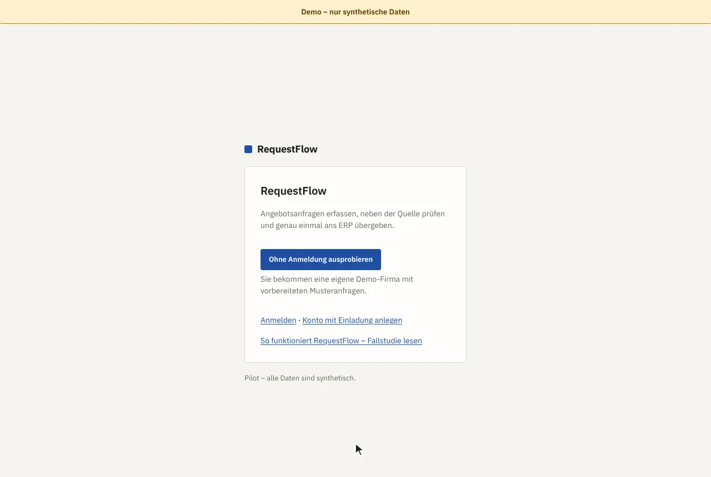
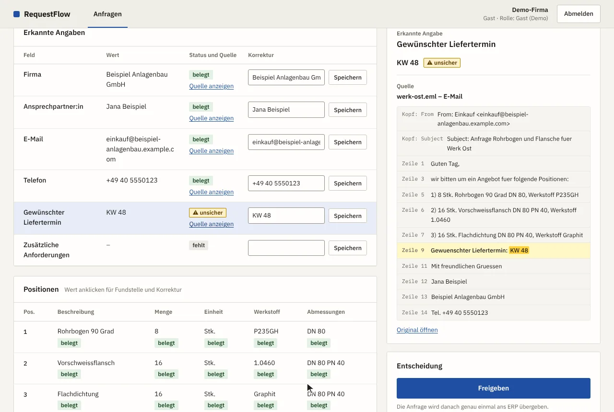
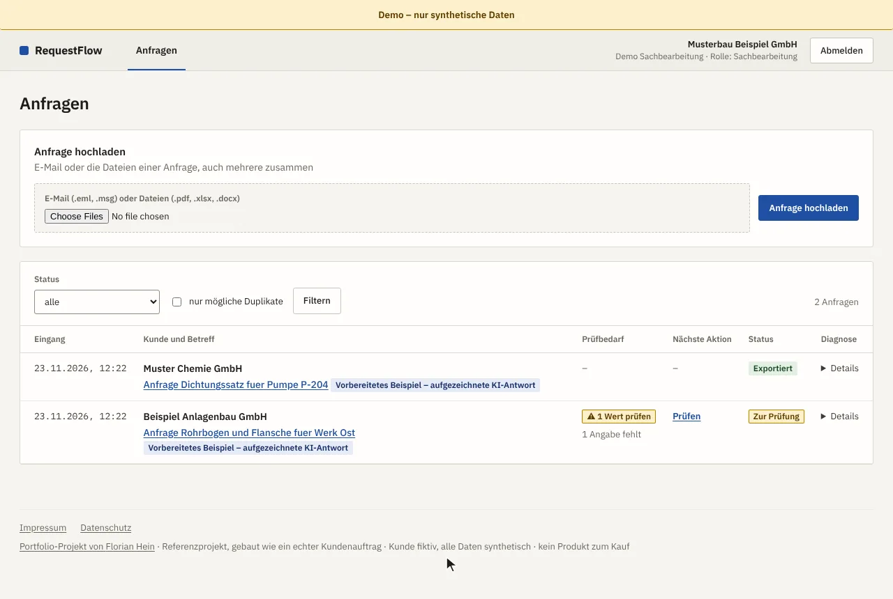

<picture>
  <source media="(prefers-color-scheme: dark)" srcset="docs/readme/title-dark.svg">
  
</picture>

> **Portfolio project** by [Florian Hein](https://final-portfolio-website-ten.vercel.app/en/): a reference project,
> built like a real customer engagement for a mid-sized machine-building company. The customer is fictional and
> **all data in this repository is synthetic**. Not a product for sale. No licence has been chosen yet (all rights reserved).

RequestFlow reads quote requests – an e-mail plus PDF, Excel or Word attachments – and turns them into structured
fields, each linked to the passage it was quoted from. A person reviews and approves every request, and each
approved request is exported to the ERP exactly once.

<picture>
  <source media="(prefers-color-scheme: dark)" srcset="docs/readme/hero-dark.webp">
  
</picture>

<sub>Motion graphic drawn with three.js and timed with GSAP, texts from the prepared sample "Werk Ost" – synthetic.</sub>

## Try it in the demo

The showcase on Vercel has a guest entry: "Ohne Anmeldung ausprobieren" creates a demo company of your own
with two prepared sample requests (their AI answer was recorded once and is replayed). Guests cannot upload;
the guest company is deleted completely after 24 hours (the default `GUEST_RETENTION_HOURS`). The pictures below are recordings of the app itself,
running locally on synthetic data.

**1 – Review every value beside its source.** "Quelle anzeigen" highlights the cited line in the original
mail. The delivery date was only given as a calendar week, so it is marked *unsicher*.



**2 – Approve, and the export happens once.** After *Freigeben* the worker sends the request to the ERP
(a mock in the pilot) with an idempotency key; the page shows the reference the ERP returned.



**3 – Upload your own mail (with an account).** For staff accounts the upload starts processing in the
background. This recording uses the AI stub of the end-to-end tests instead of the model, so the values are the
stub's – the flow, the screens and the source links are the app's.



## How it works

<picture>
  <source media="(prefers-color-scheme: dark)" srcset="docs/readme/pipeline-dark.svg">
  
</picture>

- **No invented data:** the model must quote its source; a deterministic verifier checks that the quote exists
  in the cited segment. Only then is a value *belegt* (found) – otherwise it is flagged for the review.
- **Nothing lost, nothing doubled:** jobs are enqueued in the same database transaction as the status change;
  the export uses an idempotency key, a unique export record and a row lock.
- **Tenant isolation:** repository scoping plus forced PostgreSQL row-level security per company.
- **Measurable AI quality:** an eval set of 15 synthetic cases with per-field metrics gates prompt and model
  changes in CI (replay mode).

Honest limits of the pilot: the ERP is a mock with the contract in `contracts/erp-export.openapi.yaml`; the
quality figures come from synthetic cases only ([evidence](docs/product/evidence.md)); the Vertex AI adapter is
tested against recorded responses, a live call is unverified; acceptance by the (fictional) customer is pending
([roadmap](docs/product/roadmap.md), M2). Details per module: [architecture map](docs/technical/architecture.md).

### What runs today

Each line is a merged PR; details in the [CHANGELOG](CHANGELOG.md).

- Invite-only login, companies, user and role management for admins; forced row-level security on every
  company-data table (schema `app`), guarded by a test (#31, #37, #38)
- Upload of `.eml`, `.msg`, PDF (scanned pages via OCR when `AI_PDF_OCR=auto`, marked as such), XLSX and DOCX,
  several files per request; duplicates flagged and decided in the UI (#32, #40, #44)
- AI extraction of the header fields and line items with a grounding verifier (#33, #39)
- Review beside the source with a status per value, audited corrections, approve or reject (#35, #42)
- Exactly-once export of the reviewed values and positions to the ERP mock (#36, #54)
- Request list led by the next action, with diagnosis, retries and reprocessing, paged (#43, #58, #95)
- Eval set of 15 synthetic cases as a CI gate (#41); correlated structured logs and health (#45, #56, #88)
- Showcase: prepared sample requests replayed from recorded AI answers (#83); guest access with a daily cap and
  complete deletion after 24 h (#126)
- Public case study `/case-study` (German, no login, no data access) (#75); Impressum and Datenschutz in the
  footer of every page

### Architecture

TypeScript modular monolith (Next.js, Node 24, Drizzle, PostgreSQL 17, pg-boss, Better Auth, S3 API) plus a
stateless Python AI service (FastAPI, docling, Gemini on Vertex AI in the EU; the showcase uses the Gemini API
free tier with synthetic data only – a dated exception, ADR-0001 D11). Rationale, alternatives and trade-offs:
[ADR-0001](docs/decisions/ADR-0001-pilot-architecture.md).

## Run it locally

Requirements: Docker, Node 24 with corepack (`corepack enable` → pnpm 9.15.9).

```bash
cp .env.example .env            # optional – the defaults are local, synthetic-data-only values
docker compose up --build       # postgres, storage, setup (migrations + bucket), web, worker
curl localhost:3000/api/health  # {"status":"ok","checks":{"database":"ok","storage":"ok"}}
```

Developing against local services only:

```bash
pnpm install
docker compose up -d postgres storage
pnpm setup:deploy               # migrations as app_owner + bucket (needs the .env.example variables)
pnpm dev
```

The AI service (`services/ai`, Python 3.13 with `uv`) needs model credentials for live extraction; without them,
the prepared samples and the end-to-end tests (AI stub) still run.

## Tests

| Command | What it covers |
|---|---|
| `pnpm verify` | lint, types, **294 unit tests** (34 files), **158 integration tests** (21 files) against real PostgreSQL and S3 storage – tenant isolation and exactly-once export on every PR –, the architecture check (dependency-cruiser), the build and `pnpm audit` |
| `pnpm e2e` | **5 browser flows** against the built app, the real worker and an AI stub: upload → review → correct → approve → export; a multi-item request; the prepared samples; the case study; security headers under the CSP |
| `pnpm evals` | the AI eval gate over **15 synthetic cases** in replay mode |
| `uv run --project services/ai pytest` | **452 tests** of the AI service (parsing, extraction, grounding, normalisers, API); 2 more need the docling layout and OCR models (`AI_TEST_DOCLING_MODELS=1`) |
| `scripts/doku-check.sh` | the documentation guard (CI and every session end) |

`pnpm verify:full` runs `verify`, the browser flows and the eval gate. Counts as of the last run on this branch.

## Deploy

The showcase runs on Vercel (app and AI service as two projects) with Supabase Postgres and Supabase Storage.
It is not a one-click import: the database roles, the S3 bucket, the secrets and the AI service come first. The
runbook with every step and variable is [docs/technical/deployment-vercel.md](docs/technical/deployment-vercel.md);
in short: create the Supabase project and roles, deploy `services/ai` as a container project, import this
repository in Vercel (*Add New → Project → Import*; framework, region and cron come from `vercel.json`), set the
variables of §4 for Production, run the first migration and the smoke check.

## Project status

Pilot scope built and released as [v0.1.0](https://github.com/Fluory/RequestFlow/releases/tag/v0.1.0)
(2026-09-28); acceptance pending. Public case study: [/case-study](https://requestflow-doc-edit.vercel.app/case-study),
app: [requestflow-doc-edit.vercel.app](https://requestflow-doc-edit.vercel.app). Not included: a real ERP
connection, a mailbox connector (requests are uploaded), production operation with customer data.

| Topic | Where |
|---|---|
| Architecture map and exceptions register | [docs/technical/architecture.md](docs/technical/architecture.md) |
| Decisions | [docs/decisions/](docs/decisions/INDEX.md) |
| Project brief, roadmap | [docs/product/](docs/product/project-brief.md) |
| Evidence: measured figures (synthetic) | [docs/product/evidence.md](docs/product/evidence.md) |
| Customer proposal (German) | [docs/product/pilot-vorschlag.md](docs/product/pilot-vorschlag.md) |
| Discovery and approvals (German) | [PROJECT-START.md](PROJECT-START.md) |
| Working rules for humans and agents | [AGENTS.md](AGENTS.md) |
| README pictures and how they are recorded | [docs/readme/](docs/readme/) |

Every change starts as an issue, lands through a pull request with a plain-language summary and a green CI,
and is never merged by its author. The process follows the fluory-system rulebook (guard hooks in `.claude/`,
docs and PR guards in `scripts/`).

## Kurzfassung (Deutsch)

KI-gestützte Erfassung von Angebotsanfragen: Daten aus E-Mails und Anhängen extrahieren, jede Angabe neben
ihrer Fundstelle prüfen und freigegebene Anfragen genau einmal ans ERP übergeben. Portfolio-Projekt von
Florian Hein – ein Referenzprojekt mit fiktivem Kunden, alle Daten sind synthetisch, kein Produkt zum Kauf.

---

Built by [Florian Hein](https://final-portfolio-website-ten.vercel.app/en/) in Heilbronn, Germany. I build software
prototypes for companies, from a document or workflow that eats time to something your team can try in a few
weeks. Case study on my website: [RequestFlow](https://final-portfolio-website-ten.vercel.app/en/work/requestflow/).
